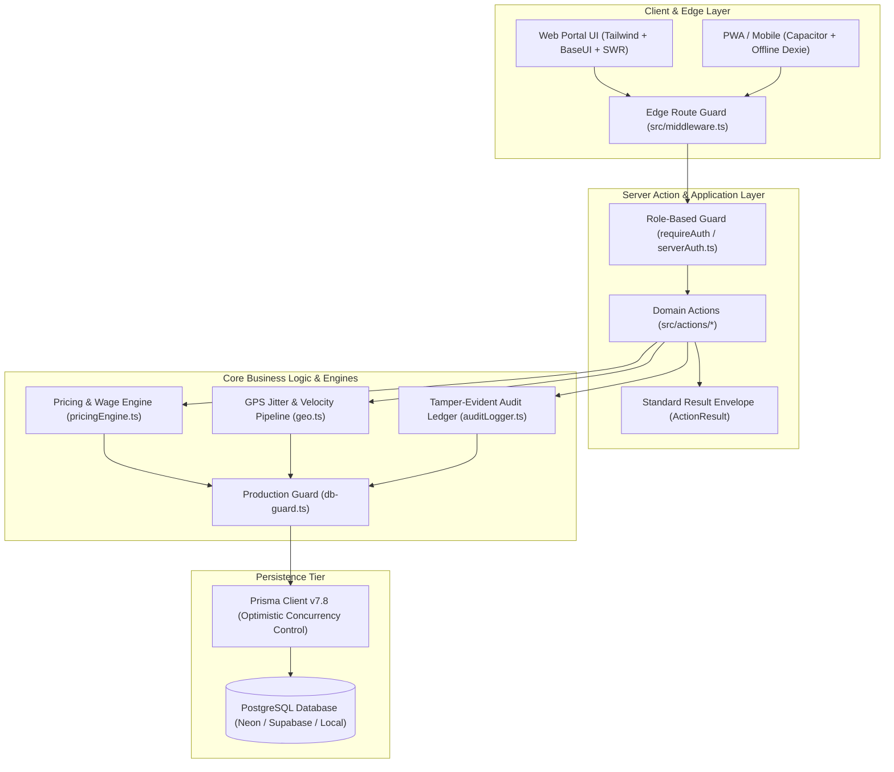
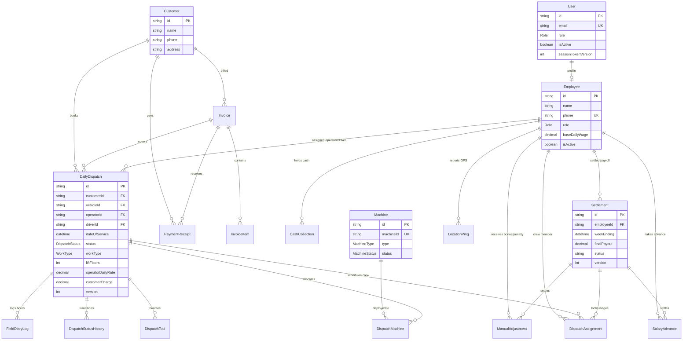

# ZERO GROUP — Enterprise Architecture & System Specification

ZERO GROUP is a mission-critical heavy machinery rental and field logistics Enterprise Resource Planning (ERP) platform built for construction operations across Kerala. The platform pairs a real-time web portal (Next.js 14 App Router, PostgreSQL, Prisma ORM, NextAuth v5) with an offline-first Progressive Web App (PWA / Capacitor) designed for site operators and conveyance drivers in remote environments with zero network connectivity.

---

## 🏛️ 1. Architectural Layers & Boundaries

The codebase adheres strictly to textbook Next.js 14 App Router layered architecture. Layers never bypass their direct lower tier:



- **Edge Middleware (`src/middleware.ts`):** Lightweight JWT session verification preventing unauthenticated route traversal before any page render or server compute.
- **Server Actions Layer (`src/actions/*`):** Single point of entry for mutations and server queries. Executes role-based access checks (`requireAuth`), Zod payload validation, and returns standardized `ActionResult<T>`.
- **Domain Services & Engines (`src/lib/*`):** Pure deterministic business rules. `pricingEngine.ts` is the single source of truth for machine rentals, multi-tier floor heights, and operator wages.
- **Database Safety Guard (`src/lib/db-guard.ts`):** Hard blocks non-test scripts or destructive seeding from ever modifying production database connections.

---

## 🔐 2. Security & 3-Layer RBAC Architecture

Every sensitive operation is enforced across 3 distinct boundaries:
1. **Edge Guard:** Evaluated in Edge Middleware (`src/middleware.ts`) across all route paths.
2. **Server Action Guard:** Enforced inside Server Actions via `requireAuth({ allowedRoles: [...] })` in `src/lib/serverAuth.ts`.
3. **UI Component Guard:** Conditional rendering and navigation guards via session claims.

### Role Permission Matrix

| Resource / Action | OWNER | ADMIN | STAFF | DRIVER | OPERATOR |
|---|:---:|:---:|:---:|:---:|:---:|
| **God Mode & Wage Overrides** | ✅ | ❌ | ❌ | ❌ | ❌ |
| **Finalize Weekly Settlements** | ✅ | ❌ | ❌ | ❌ | ❌ |
| **Resolve Flagged Incidents** | ✅ | ❌ | ❌ | ❌ | ❌ |
| **Daily Dispatch Creation** | ✅ | ✅ | ✅ | ❌ | ❌ |
| **Invoice Adjustments (≤ ₹500)** | ✅ | ✅ | ✅ | ❌ | ❌ |
| **Invoice Adjustments (> ₹500)** | ✅ (Approval) | PENDING | PENDING | ❌ | ❌ |
| **Driver Order Acceptance & Map** | ✅ | ✅ | ✅ | ✅ | ❌ |
| **Operator Field Diary Logging** | ✅ | ✅ | ✅ | ❌ | ✅ |
| **GPS Telemetry Submission** | ✅ | ✅ | ✅ | ✅ | ✅ |

---

## 📊 3. Entity-Relationship Diagram (ERD)



---

## ⚡ 4. Standardized Server Action API Protocol

All Server Actions return a uniform, strongly typed response envelope defined in `src/lib/action-result.ts`:

```typescript
export type ActionResult<T = void> =
  | { success: true; data: T; error?: never; code?: never }
  | { success: false; error: string; code?: string; data?: never };
```

### Modularized Action Domain Facades
- **`src/actions/settlement.ts`:**
  - `calculateOperatorSettlement(input)`: Computes labor earnings, advances, bonuses, and net payout.
  - `calculateWorkerLedgerBalances(input)`: Aggregates weekend multi-crew balances with itemized booking histories.
  - `createManualAdjustment(input)`: Submits bonuses or penalties with delegated ₹500 authority thresholds.
  - `finalizeWeeklySettlement(input)`: Immutably locks weekend payroll, settles advances, and records audit logs.
- **`src/actions/dispatch.ts`:**
  - `createDailyDispatch(formData)`: Validates machine compatibility, enforces strict driver/operator role segregation, and locks pricing.
  - `updateDispatchStatus(formData)`: Records audit-locked status transitions (`DispatchStatusHistory`) and releases plant assets upon completion.
  - `updateDailyDispatch(formData)`: Edits dispatch with Optimistic Concurrency Control (OCC `version`).
  - `reportDriverIncident(formData)`: Triggers critical incident alerts on site operations board.

---

## 📡 5. Geolocation Pipeline & Jitter Elimination

Site and driver tracking runs through a multi-stage sanitary pipeline (`src/lib/geo.ts`):
1. **Accuracy Threshold:** Reject GPS pings with horizontal accuracy $> 100\text{ m}$.
2. **Velocity Sanity Check:** Reject consecutive pings implying velocities $> 130\text{ km/h}$ to eradicate satellite bounce.
3. **Dead-Zone Clustering:** Buffer readings locally via Dexie IndexedDB when off-grid, flushing via FIFO queue upon signal restoration.

---

## 🧪 6. Testing & Quality Verification Suite

Testing is partitioned into distinct validation tiers:
- **Unit & Security Tests:** Jest execution covering DB guards, geometric filters, and RBAC authorization boundaries (`npm run test`).
- **System End-to-End Tests:** Playwright chromium suite (`npm run test:system`).
- **Full Operational Simulation:** Multi-agent 28-day schedule replay verifying ledger integrity, cash collections, and stock balances (`npm run test:simulation`).
- **Test Database Isolation:** Test suites run against dedicated `project7_test` with mandatory guard validation in `db-guard.ts`.
